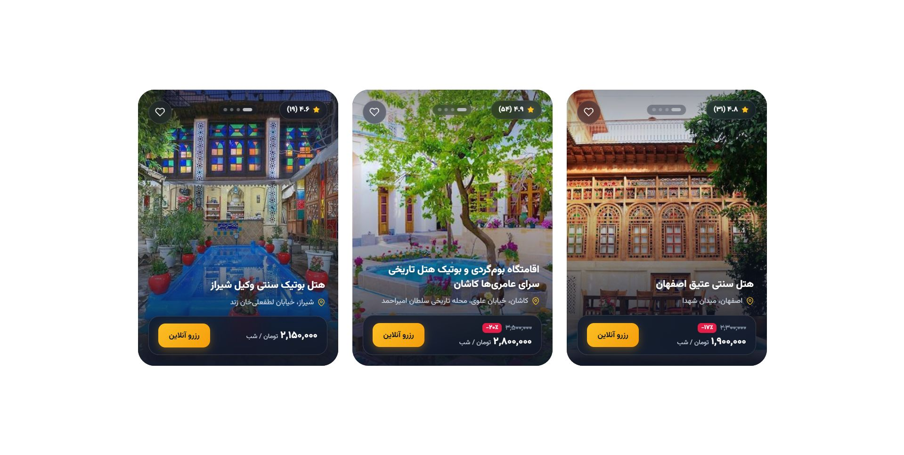
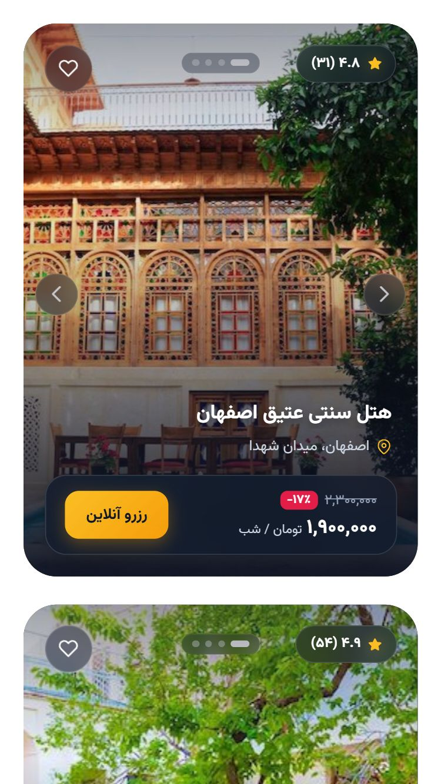
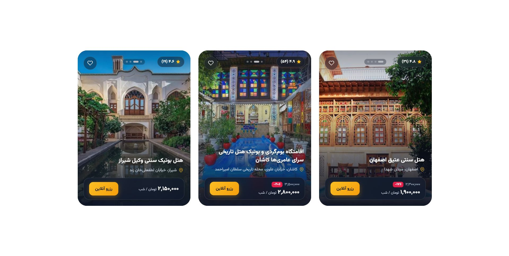

# Hotel Card

A responsive hotel card with an image slider and a glass-style design. Built with HTML, CSS, vanilla JavaScript and Swiper, with full RTL (Persian) support.

**Live demo:** https://smah-ir.github.io/hotel-card/

## Screenshots

## Features

- Swiper image slider with navigation and pagination
- Glassmorphism card design
- RTL layout with Persian typography (Vazirmatn, self-hosted)
- Responsive from mobile to desktop
- Inline SVG icons, no icon-font dependency
- Keyboard focus styles and readable contrast

## Tech Stack

HTML5, CSS3, JavaScript (ES6), Swiper

## Run locally

Open `index.html` in a browser, or use any static server such as the VS Code Live Server extension.

## Credits

- Font: [Vazirmatn](https://github.com/rastikerdar/vazirmatn) (OFL license, included in `fonts/`)
- Slider: [Swiper](https://swiperjs.com/)
- Hotel photos used with permission. Hotel names are fictional.